# Memory UI — visual language

Applies to every memory surface: Settings › 记忆 card, the chat recall chip, and
the Memory Center (Kaleidoscope › 记忆). It refines the app's existing calm,
Linear/Raycast-style chrome — it does not introduce a new style. Reference
surfaces it builds on: `ui/src/features/settings/components/SettingsNav.tsx`
(muted selection + 2 px primary bar), `ui/src/features/settings/components/primitives/*`
(rows, cards, toggles), `ui/src/components/chat/MemoryRecallChip.tsx`,
`ui/src/components/memory/FragmentCard.tsx`.

## Principles

1. **Calm density.** Many small facts on screen, little chrome. Hairlines over boxes,
   whitespace over dividers, one accent per view.
2. **Information first.** The memory's text is the hero; kind, source and time are
   quiet metadata on one line under it.
3. **Provenance visible.** Every memory shows where it came from (conversation, capture,
   import) and when — never a bare claim.
4. **Quiet motion.** Motion explains a change (appear, progress, expand); it never
   decorates. Everything respects `prefers-reduced-motion`.

## Type scale

| Token | px / line-height | Weight | Use |
|---|---|---|---|
| caption | 11 / 16 | 400–500 | metadata, badges, timestamps |
| body-sm | 12 / 18 | 400 | secondary text, pills, helper copy |
| body | 13 / 20 | 400; 500 for item titles | memory text, rows |
| title | 15 / 22 | 600 | card / section titles |
| display | 20 / 28 | 600 | Memory Center page title, one big number |

Use `text-[11px]` … `text-[20px]` with `leading-*`; no other sizes (retire ad-hoc
`text-[10px]` / `[10.5px]`). Numbers use `tabular-nums`. Chinese text: no letter-spacing;
`uppercase tracking-wider` only for Latin eyebrow labels.

## Spacing, radius, elevation

- **Spacing:** 4 / 8 / 12 / 16 / 24 (`1 / 2 / 3 / 4 / 6`). Inside a row 8; between rows
  12; card padding 16; between sections 24.
- **Radius** (from `--radius: 0.5rem`): badges/pills `rounded-full`; inputs/small
  controls `rounded-md` (6 px); cards and list items `rounded-lg` (8 px); dialogs and
  the Memory Center panes `rounded-xl` (12 px). Never mix within one component.
- **Elevation:** two levels only, theme-aware CSS variables.
  - `shadow-elevation-1` (`--elevation-1`) — resting card / chip. Light: a faint
    foreground-tinted 1–2 px shadow (picks up each theme's hue). Dark: an inset 1 px
    top highlight + tight black shadow (Linear-style lift, no grey haze).
  - `shadow-elevation-2` (`--elevation-2`) — popovers, sheets, the detail panel.
  - Flat lists use hairlines (`border-border/50`), not shadows.

## Motion

| Duration | Use |
|---|---|
| 120 ms | hover / press, color & border changes |
| 180 ms | enter of chips, rows, popovers (opacity 0→1 + `y: 4→0`) |
| 240 ms | progress fill glide only |

State changes otherwise stay ≤ 200 ms (panel/sheet enter, expand/collapse use 180 ms);
the 240 ms progress glide is the single exception, because it smooths bursty download
events rather than reacting to a user action. Ease-out (`[0.16, 1, 0.3, 1]` in `motion/react`, `ease-out` in CSS) for enters; exits
are ~70 % of the enter duration with ease-in. Animate `transform`/`opacity` only. Lists
stagger 30 ms per item, max 8 items. Under reduced motion: no translate, no shimmer, no
sweep — fades ≤120 ms or instant (`motion-safe:` / `motion-reduce:` variants;
`useReducedMotion()` in `motion/react`).

## State patterns

- **Loading — skeleton.** `MemorySkeleton` blocks sized to the real content (title line
  `h-3 w-2/3`, body `h-3 w-full`, meta `h-2.5 w-24`). Faint sheen (`--foreground` at 5 %)
  sweeping every 1.6 s; static under reduced motion. Mark the container `aria-busy`.
  Show skeletons only after ~150 ms to avoid flashes; never a centered spinner for lists.
- **Empty.** Centered in the pane: a 20 px lucide icon in `text-muted-foreground/60`,
  one 13 px/500 line saying what's missing ("还没有记忆"), one 12 px muted line with
  why/what next, at most one secondary button. No illustrations.
- **Error.** Inline callout, not a toast, kept soft: `bg-danger-bg/50` tint + a
  `border-danger/20` hairline, `rounded-lg`, a 14 px `text-danger` icon and a 13 px/500
  title in `text-danger`; everything else muted. One 12 px line with the cause derived
  from the error (network / 磁盘空间不足 / 权限 — never claim a cause the error doesn't
  show; fall back to a neutral "下载未完成，请稍后重试") plus what still works ("目前仍可按
  关键词检索"), then a concrete action button (重试 / 打开设置). The raw error goes behind a
  small "详情" disclosure (Radix Collapsible, 11 px mono, wraps and scrolls — never
  truncated mid-URL), not in primary text. Keep the stale data visible underneath when
  there is any.
- **Progress.** `ProgressBar` — 4 px hairline, `--progress-track` / `--progress-fill`.
  Determinate glides 240 ms; indeterminate (unknown total) sweeps; it must be named
  (`label` or `aria-labelledby`, enforced by the type) ("下载记忆模型") and show the numbers as text next to it (`12.4 / 90 MB`).
- **Stats.** `StatPill` — quiet label (`text-foreground/80`), toned value (`neutral |
  success | warning | danger`). A row of pills should read as data. Text that sits on a
  tinted surface (pill values, callout titles) uses the `-strong` variants
  (`text-success-strong` …: the tone mixed 60 % with `--foreground`), and secondary
  text on a tint uses `text-foreground/75` — plain `--success` / `--muted-foreground`
  drop below 4.5:1 on their tints in several themes.

## Kind colors

Six kinds, each with an ink (`--memory-kind-<k>`) and a tinted surface
(`--memory-kind-<k>-bg`), defined in `ui/src/styles/globals.css` for `:root`, `.dark`
and all 10 named themes; mapped in `tailwind.config.js` as `bg-memory-<k>`,
`text-memory-<k>`, `bg-memory-<k>-bg`, `border-memory-<k>/20` (always `/20` for kind
borders).

| Kind | 中文 | Base hue | Rationale |
|---|---|---|---|
| fact | 事实 | 234 slate-blue | steady, neutral knowledge |
| preference | 偏好 | 318 orchid | personal, warm — but clear of danger red |
| episode | 事件 | 70 sand / khaki | lived moments; clear of warning amber |
| lesson | 经验 | 108 olive-leaf | growth; clear of success green |
| entity | 实体 | 270 violet | people, things — the "who" |
| procedure | 技能 | 200 teal-cyan | doing, skills |

**Hue budget.** The semantic status colors own three zones: danger ≈ 350–10,
warning ≈ 30–40, success ≈ 142–175 (warm-paper: 95). Kinds must stay ≥ 25° from each
of them and ≥ 30° from each other (circular distance), so a 偏好 badge never reads as an
error and an 事件 badge never reads as a warning next to a `StatPill`. Kinds live in the
two free arcs — 60–117 (episode, lesson) and 200–325 (procedure, fact, entity,
preference). warm-paper's success is olive (95), so there lesson moves to 146 and
episode to 59. Per-theme minimums (pair gap / semantic gap): `:root` 34/34, `.dark`
34/30, ocean 30/26, forest 34/33–34, slate 36/31, warm-paper 36/29, qingye 34/31,
black 34/26, the-finals 36/27.

Rules: **restrained chroma** (28–45 % saturation; 55 % only on the high-contrast black /
the-finals themes) — premium means quiet. Each theme pulls the hues ≤4° toward its own
hue (ocean → blue, forest/qingye → green, slate/warm-paper → earth, the-finals → warm)
and sets its own saturation/lightness, so kinds harmonize instead of looking pasted on.
Badge text is solved per theme for **≥ 4.5:1 on its `-bg` and on the theme card**
(guarded by `ui/src/styles/memory-tokens.test.ts`, which also enforces the hue budget, the `-strong` / `foreground/75–80` text on tints
above and progress fill ≥ 3:1 on track). Progress fill is neutral or the theme's brand
tone, never a status hue (the-finals uses warm cream, not its red; black uses neutral
silver, because its gold brand tone is indistinguishable from its warning amber). Color is never the only signal: badges always carry the label.
Components never use raw palette classes (`blue-500` …) — only these tokens or the
existing semantic ones (`success`, `warning`, `danger`, `muted`).

## Primitives (`ui/src/components/memory/primitives/`)

`<KindBadge kind variant="label|dot" size="sm|md" />`,
`<ProgressBar value={0..1} indeterminate? label | aria-labelledby />` (a name is required),
`<StatPill label value tone />`, `<MemorySkeleton className="h-3 w-24" />`,
plus `MEMORY_KINDS` / `MEMORY_KIND_LABELS` / `MEMORY_KIND_CLASSES`.

## Copy tone

Chinese, short, plain. Primary text names the thing the user cares about ("记住了你偏好
简洁回答"), not the mechanism — no "embedding", "FTS", "bucket", "vector" in primary
text; put technical detail in secondary/tooltip text or 高级. Status in 2–6 characters
(已就绪 / 下载中 / 未启用). Errors: cause + next step. No exclamation marks, no emoji.

## Reference screenshots

Captured from the browser mock (`npm run dev:mock-tauri`; `?memoryCore=<state>` for
Settings › 记忆, `?memoryRecall=hybrid|keyword` for the chip, `&memoryCoreDelay=<ms>` to
hold the skeleton) in `docs/design/screenshots/p1-ui/`. File names are
`settings-<state>-<theme>-<width>.png` and `chip-<mode>-<theme>-1280.png`. Key ones:

| Surface | Light | Dark |
|---|---|---|
| Ready | 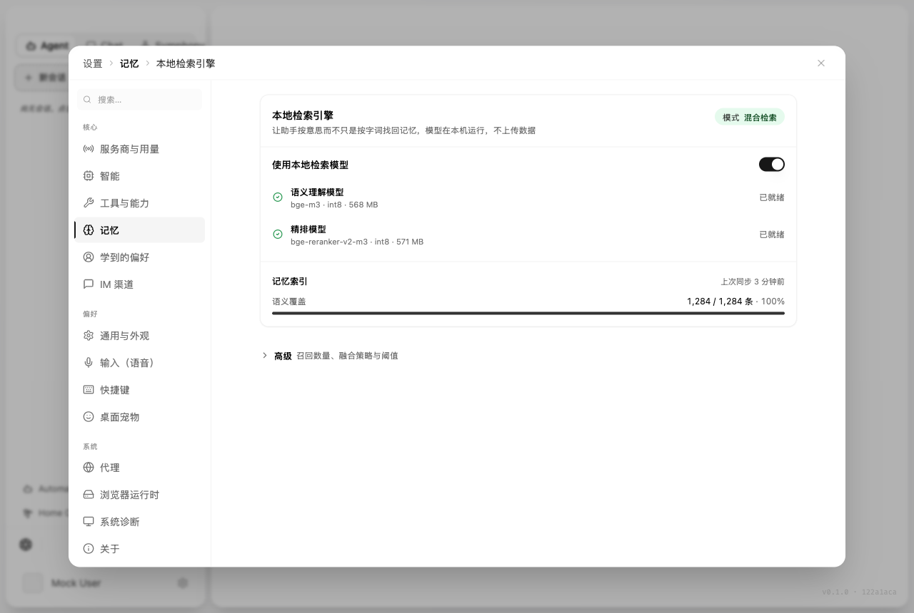 | 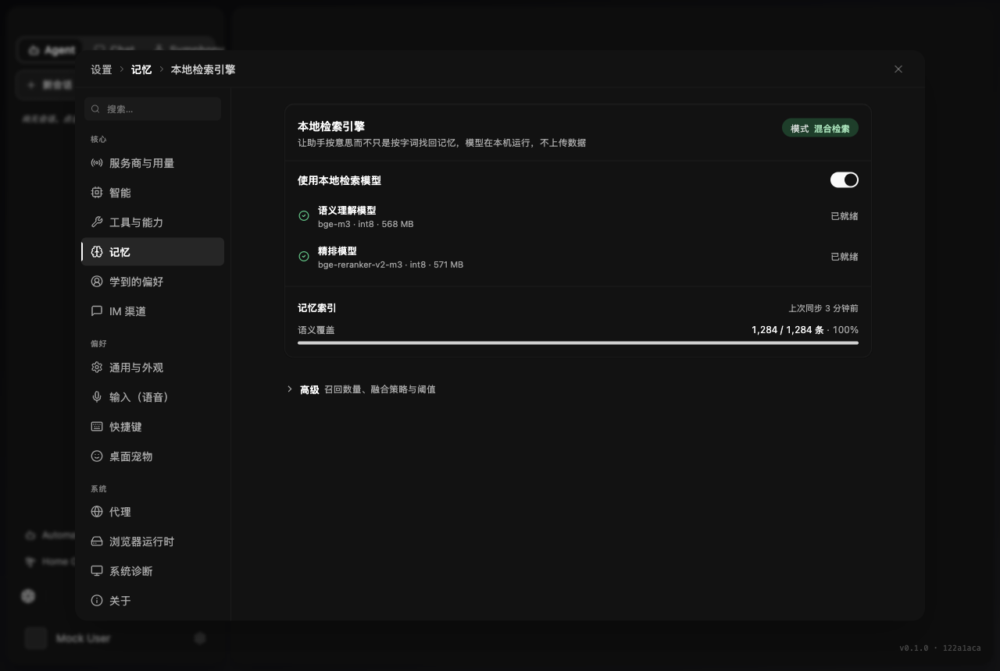 |
| Downloading | 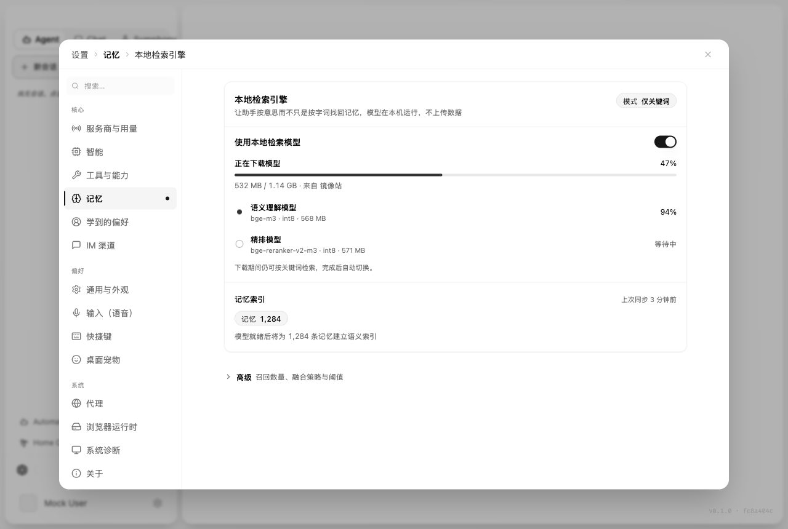 | 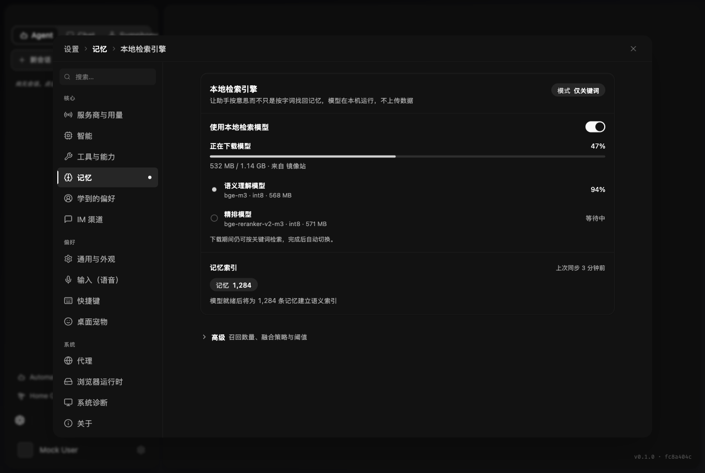 |
| Failed (callout) | 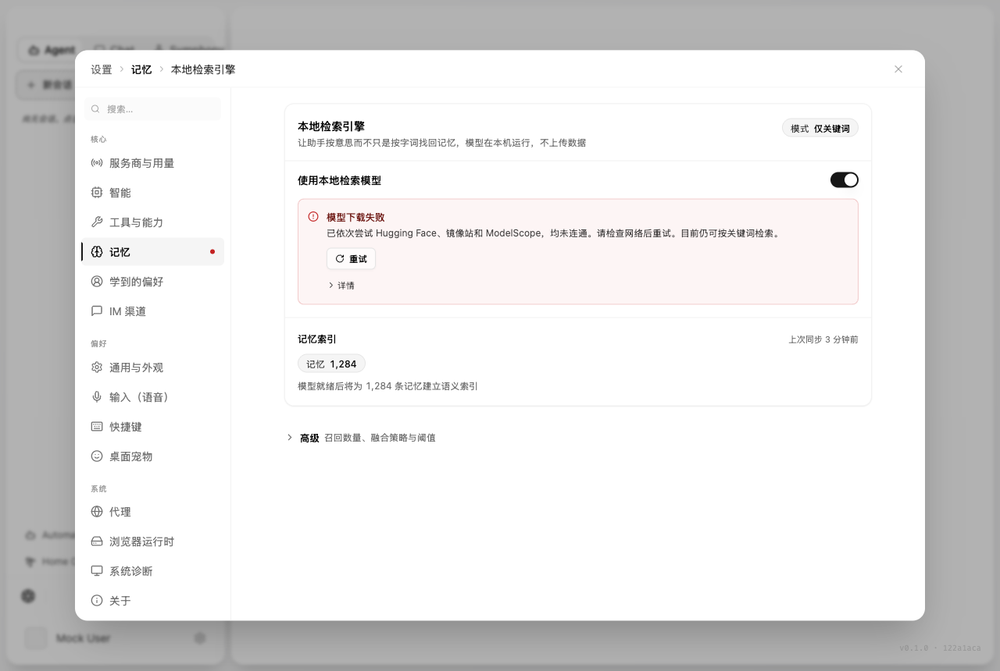 | 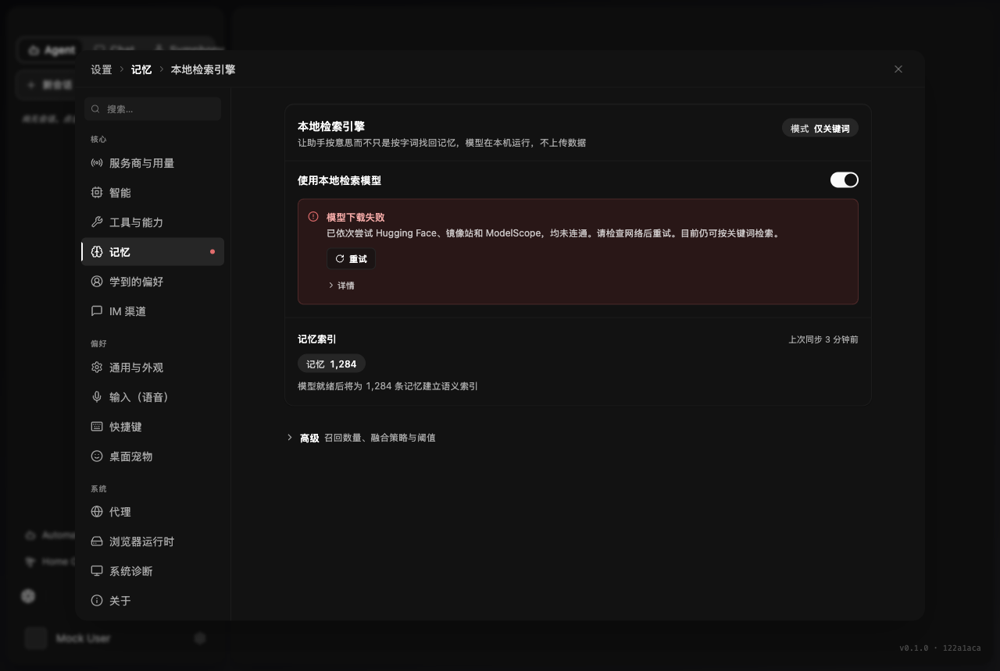 |
| Off (keyword only) | 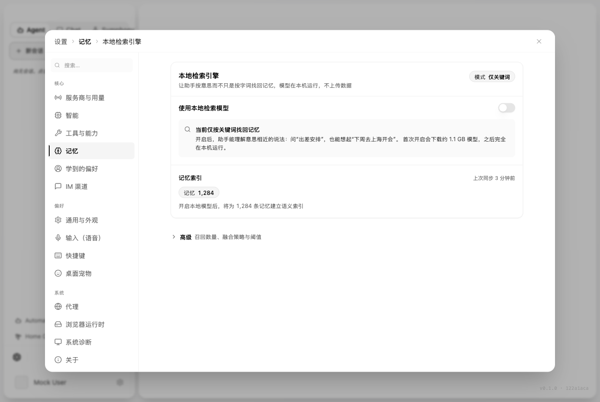 | 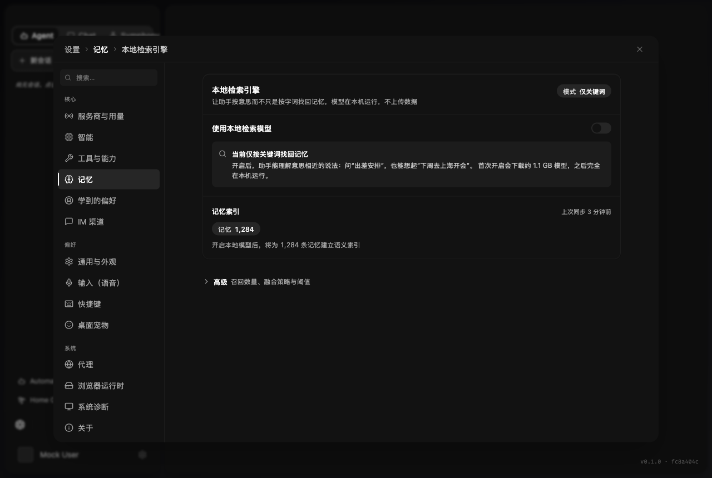 |
| Loading skeleton | 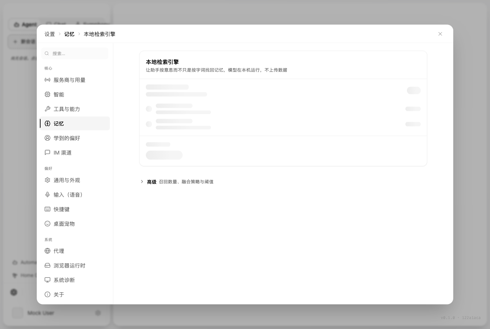 | 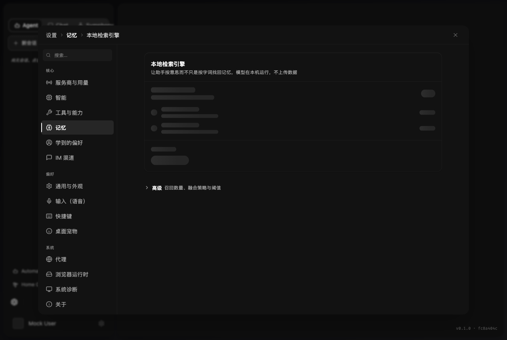 |
| Recall chip (hybrid) | 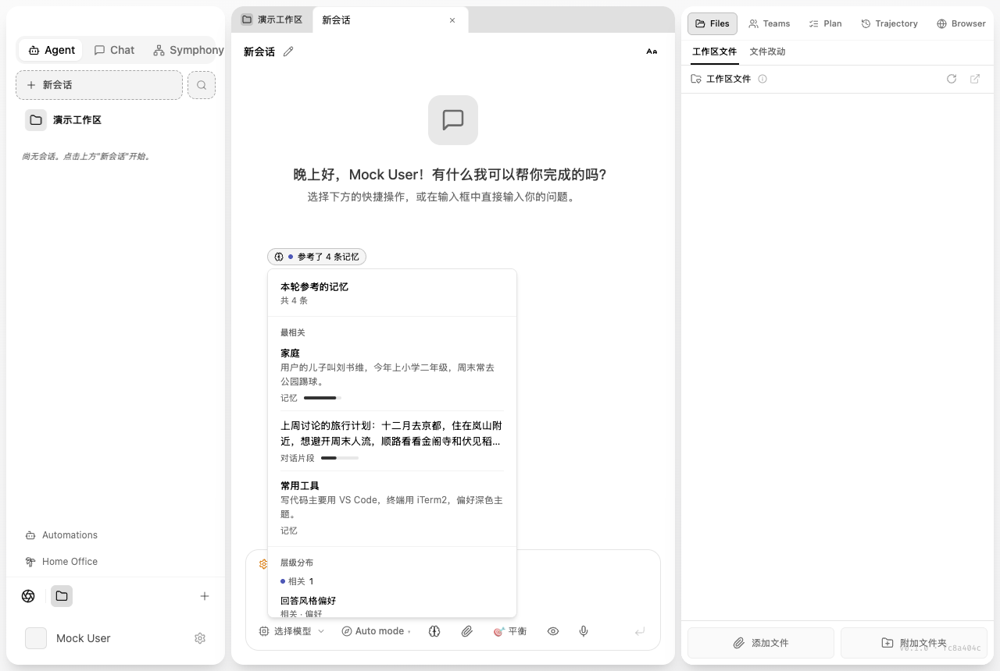 | 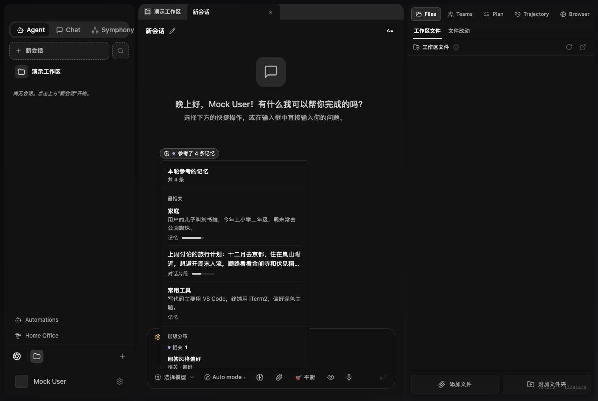 |
| Recall chip (keyword) | 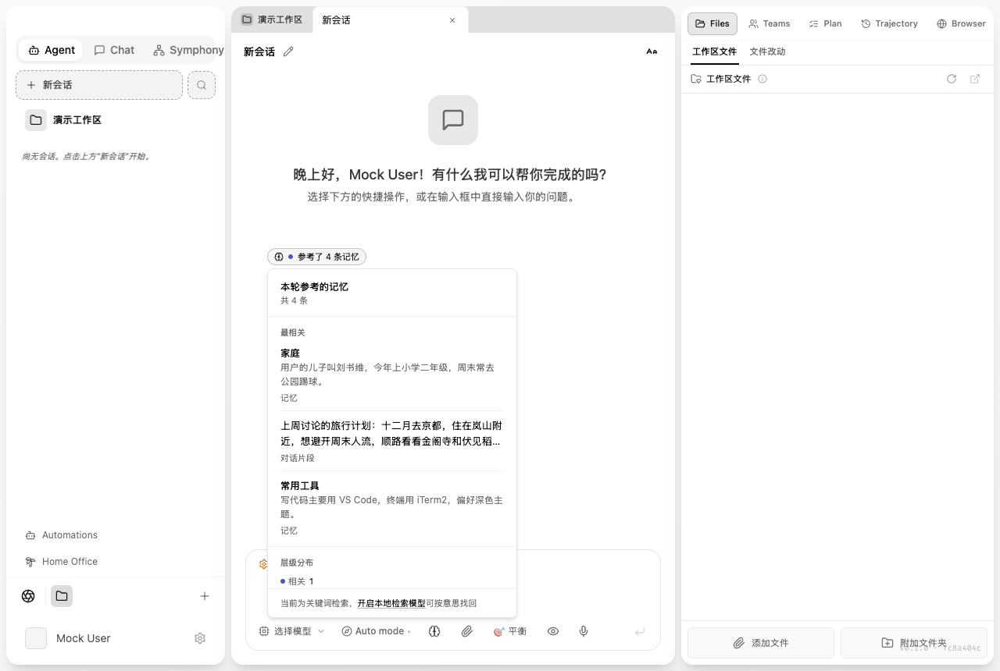 | 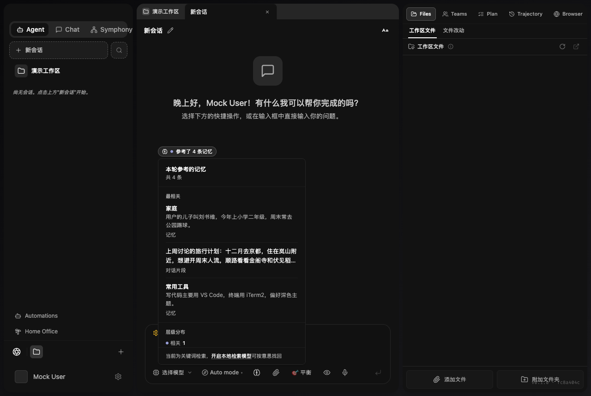 |

Named themes (warm-paper, qingye, black, slate-dark) and the ~720 px narrow layout are in
the same folder.

